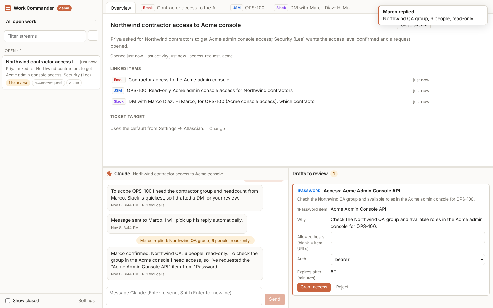
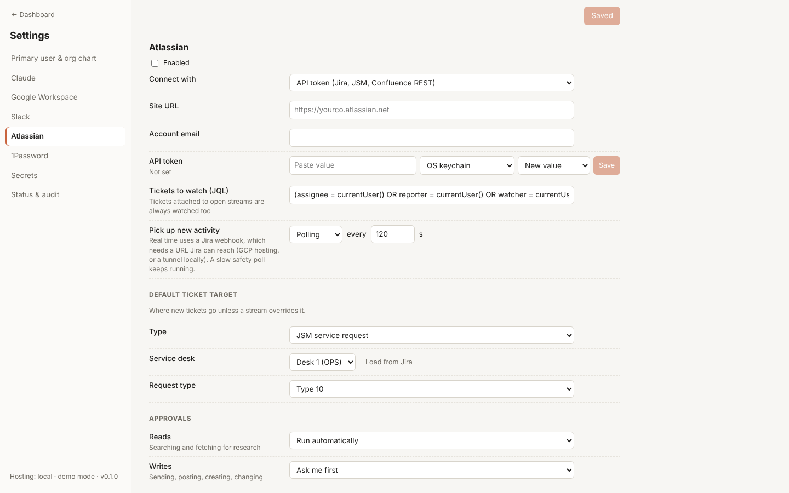

# Work Commander

One dashboard for all of a person's work streams, with Claude in the middle. Claude reads incoming email, Slack and Jira/JSM activity, decides what actually needs the **primary user (PU)**, groups it into work streams, and prepares the replies, tickets and messages. Each draft sits in an editable pane, and nothing is sent until the PU approves it. That approval is configurable per system.



## What it does

- **Triage.** New activity from Gmail, Slack and Jira/JSM is checked against the PU's identity, org function, org chart and "what matters" notes. Noise is dropped. Relevant activity is attached to an existing work stream or opens a new one, with a title and summary Claude writes.
- **Drafts, not actions.** Claude prepares email replies, Slack messages (posted as the PU), JSM requests or Jira issues, ticket comments and transitions, and 1Password access requests. Each appears in the **draft pane** with directly editable fields. The PU edits the wording, approves, or rejects with a reason Claude sees.
- **Ordered execution.** Drafts can depend on each other. A reply that says "I've opened {{ticket.key}}" waits for the ticket and gets the real key filled in.
- **Carry the work forward.** After drafts are decided and executed, Claude is told the outcome, including what the PU edited, and takes the next step: offering to work a ticket, asking someone on Slack, requesting access, drafting the resolution, proposing to close the stream.
- **Access without secrets in the prompt.** When research needs a system the PU controls, Claude asks for a 1Password item. On approval it gets a time-limited *grant* for an `http_request` tool. The server injects the credential only for the approved hosts, and Claude never sees it.

### The example work stream, as implemented

| Step | What happens |
|---|---|
| Someone emails the PU, CCing others; another person replies asking the PU for more | Gmail ingestion → triage marks it relevant, opens a stream, notifies the PU |
| Claude offers a ticket and a reply-all | Two drafts: *Create JSM ticket* (requester = original asker, assignee = PU) and *Reply* containing `{{ticket.key}}`, which runs after the ticket |
| PU tweaks the email and approves both | The ticket is created, then the email is sent with the real key |
| Claude notices the ticket waiting and offers to resolve it | A question card with "Yes, work on it" / "Not now" |
| More info is needed from someone on the thread | A Slack DM draft to that person, posted as the PU on approval; the thread is tracked |
| They reply on Slack | Ingestion routes the reply to the same stream; Claude continues the research |
| Research needs a system the PU controls | A 1Password access request; approving creates a host-scoped, expiring grant |
| Claude finishes | Drafts for the ticket reply, the status change and the email; PU edits the ticket reply and approves |
| Done | Claude proposes closing the stream; closed streams are hidden by default |

`npm run demo` runs exactly this flow with in-memory stand-ins (see below), and `apps/server/test/flow.test.ts` asserts it end to end.

## Layout

- **Left:** work streams, labelled by Claude, Open/Closed (closed hidden by default), with drafts-to-review counts.
- **Top tab bar and pane:** everything attached to the selected stream (email threads, Slack threads, tickets), plus an Overview tab.
- **Bottom left:** Claude chat. It knows the selected stream and tab, and is aware of all open streams.
- **Bottom right:** the draft pane, shown only when something is waiting for approval.
- **Settings:** PU identity, org chart import (Workday REST, Workday RaaS, CSV/XLSX upload, Jira Assets), the Claude provider, each integration (API or MCP), ingestion mode and approval policy per system, and secret storage per credential.



## Quick start

Requires Node 20+.

```bash
npm install
npm run demo          # in-memory Gmail/Slack/JSM/1Password and a scripted agent; no credentials needed
# open http://localhost:5173
```

To run for real on your machine:

```bash
npm run build
npm start             # serves the dashboard and API on http://localhost:8787
```

Then open **Settings** and work through [docs/setup.md](docs/setup.md). For local use with your own Claude Code sign-in, run `claude` once in a terminal and log in.

For development with hot reload, use `npm run dev` (API on :8787, UI on :5173).

## How Claude is reached

Chosen in **Settings → Claude**. All three use the [Claude Agent SDK](https://code.claude.com/docs/en/agent-sdk/overview):

| Provider | Where it works | Notes |
|---|---|---|
| Claude Code login | Local only | Uses the PU's own `claude` sign-in on that machine. Anthropic doesn't allow offering claude.ai login to other users, so it's limited to a local instance used by one person. |
| Vertex AI | Local and GCP | Uses Application Default Credentials; Claude must be enabled in the Vertex project. |
| Anthropic API key | Local and GCP | The key is stored like any other credential. |

## Integrations

Each system can connect through its **API** or through an **MCP server**, chosen per system.

| System | API mode | MCP mode | Real-time ingestion |
|---|---|---|---|
| Google Workspace | OAuth as the PU: Gmail (read and send), Drive and Calendar (read) | Any Google MCP server | Gmail push via Pub/Sub (pull subscription, so it also works locally) |
| Slack | User token (posts as the PU) and app token | Any Slack MCP server | Socket Mode |
| Atlassian | Site URL, email and API token: Jira, JSM, Confluence | Any Atlassian MCP server, e.g. Atlassian's remote MCP | Jira webhooks (public URL needed; on GCP via the relay) |
| 1Password | Service account, Connect server, or CLI with the desktop app | n/a | n/a |

Each system can also use **polling** at an interval you set. MCP-mode systems poll only: on each poll, Claude uses the server's read-only tools to collect new activity.

## Security model

- **Credentials** never go in the dashboard database. Each credential is stored in the backend you pick for it: OS keychain (local), GCP Secret Manager, or 1Password. The database holds only a reference. Values are write-only in the UI.
- **Approvals**: per system, reads and writes are each "run automatically" or "ask me first". The defaults are reads automatic and writes ask first; for 1Password, both ask first. 1Password access requests always need approval.
- **The agent can only do what the dashboard gives it.** Claude Code's built-in tools (shell, file editing) are disabled. Web search is off unless you enable it. External MCP writes are intercepted and turned into drafts, and the server executes them with exactly the arguments you approved.
- **Dashboard access**: locally the server binds to 127.0.0.1 and rejects foreign Host and Origin headers. On GCP it runs behind Identity-Aware Proxy, verifies the IAP JWT, and accepts only the PU's identity.
- **Audit log**: every approval, rejection, execution, automatic write and grant use is recorded (Settings → Status & audit).

## Hosting

- **Local:** `npm start`, with SQLite in `~/.work-commander`. This is the only mode that supports the OS keychain and Claude Code login. `docker-compose.yml` is provided if you prefer a container; inside it, use Secret Manager or 1Password, and Vertex or an API key.
- **GCP:** `deploy/gcp-deploy.sh <project>` builds with Cloud Build and applies `deploy/terraform`. That creates Cloud Run (one always-on instance, IAP-protected), Cloud SQL Postgres, Secret Manager, Pub/Sub for Gmail push and Jira webhooks, the small public Jira webhook relay, and a service account with the needed roles. See [docs/setup.md](docs/setup.md#deploying-to-gcp).

## Repository layout

```
apps/server     Fastify API, ingestion, triage, agent runner, executor (TypeScript)
apps/web        React dashboard (Vite)
packages/shared Types shared by both
deploy/         Terraform for GCP, deploy script, Slack app manifest
docs/           Setup guide and architecture notes
```

More detail in [docs/architecture.md](docs/architecture.md).

## Development

```bash
npm run typecheck
npm test              # unit tests + the end-to-end example flow
```

## Status

The full flow is exercised against in-memory stand-ins and a scripted agent. The real Agent SDK path has been checked to start and authenticate. The Google, Slack, Atlassian, 1Password, Workday and Jira Assets clients are written against their public APIs but have **not yet been run against live accounts**, and the Terraform has not yet been applied. Expect some first-connection fixes.
