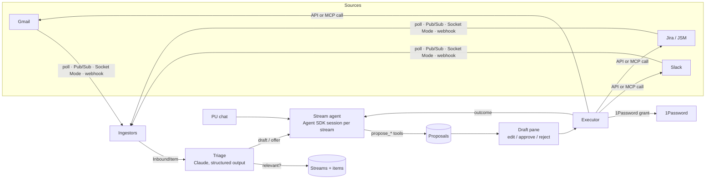

# Architecture

## Moving parts (apps/server/src)

| Module | Role |
|---|---|
| `integrations/*` | API clients and ingestors for Google, Slack, Atlassian; the MCP client; `hub.ts` starts or stops ingestion when settings change |
| `agent/triage.ts` | The inbound pipeline: upsert the item, dedupe the event, skip PU-authored messages, ask Claude for a `TriageDecision`, route to a stream, then draft or offer |
| `agent/runner.ts` | One Agent SDK session per stream (resumed across turns; recap fallback if lost), one queue per stream, live text streamed to the UI, and the gate for external MCP tools |
| `agent/tools.ts` | The tools Claude gets: read tools (policy-wrapped), `propose_*` tools that create drafts, internal tools (stream updates, org chart lookup, questions to the PU) |
| `core/executor.ts` | Runs approved proposals in dependency order, fills `{{ticket.key}}`-style placeholders, attaches resulting items to the stream, reports back to the agent |
| `onepassword/*` | The three 1Password access modes; credential grants and the host-scoped `http_request` |
| `secrets/store.ts` | Per-credential storage in the keychain, Secret Manager or 1Password |
| `orgchart/import.ts` | Workday REST, Workday RaaS, CSV/XLSX and Jira Assets import with field mapping |
| `auth/guard.ts` | Localhost protection or IAP JWT verification |
| `demo/*` | In-memory world and scripted agent for `DEMO_MODE` and tests |

## Key decisions

- **Proposals are the only way anything leaves the dashboard.** A proposal has an editable payload, a list of editable fields for the UI, and optional dependencies. Approval with edits stores the edited payload, so the agent is told what changed and can match the PU's style.
- **A turn ends when drafts are created.** The agent doesn't block waiting for approval. When every proposal from a run is decided and executed, the runner resumes the stream's session with a summary of outcomes. This survives long gaps (the PU approves hours later).
- **External MCP writes are deferred, not denied.** When Claude calls a write tool on the PU's MCP server, the permission gate records a proposal and tells Claude it's queued. After approval, the server calls that tool itself through its own MCP client with the approved arguments. Reads run directly if the policy allows.
- **Read approvals.** If a system's reads are set to "ask me first", read tools create a `read_approval` proposal. After approval, the server runs the read and returns the result to the agent.
- **Single PU per instance.** Each deployment serves one person. On GCP this is enforced by IAP and an email check. The Cloud Run service runs exactly one always-on instance because queues and Socket Mode live in-process.
- **Storage.** SQLite locally, Postgres on GCP, behind the same Kysely schema. Agent SDK session files live in the data directory. On Cloud Run they're ephemeral, so a lost session falls back to a fresh one seeded with a chat recap.

## Data model

`streams`, `items` (unique by source + external id; thread messages merged idempotently), `inbound_events` (dedupe and the triage decision), `proposals`, `chat_messages` (including suggestion and question cards), `grants`, `people`, `credentials` (references only), `settings`, `sync_state` (ingestion cursors), `audit_log`.
